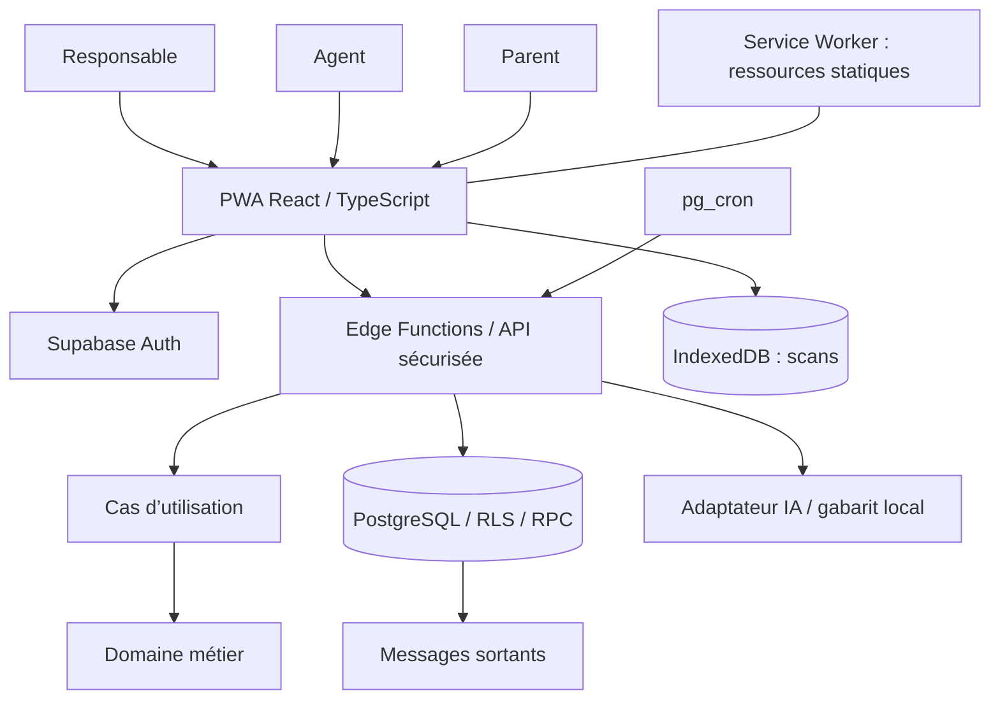

# Architecture logicielle

Statut : architecture validée dans la stack ; implémentation à poursuivre. Source : sujet B, sections 2.1, 2.2 et 3.

## Vue d’ensemble

Monolithe modulaire avec une seule PWA et un backend métier TypeScript/Deno sur Supabase. Les rôles disposent de routes et d’interfaces propres, mais partagent les composants et les contrats nécessaires. Les Edge Functions constituent des points d’entrée HTTP ; elles n’impliquent pas une architecture microservices.



## Clean Architecture

Les dépendances de code pointent vers les couches internes. Les détails techniques ne déterminent pas les entités métier.

| Couche | Responsabilité | Ne doit pas dépendre de |
|---|---|---|
| Domaine | Entités, objets de valeur, invariants, règles métier pures | React, SDK Supabase, HTTP, persistance, OpenAI |
| Application | Cas d’utilisation, ports, orchestration, autorisation métier | Adaptateurs concrets et frameworks d’entrée |
| Infrastructure | Repositories SQL/Supabase, IndexedDB, crypto, IA, horloge, notifications | Interface utilisateur |
| Présentation | Contrôleurs HTTP, validation de transport, composants React, mapping des erreurs | Détails de persistance utilisés directement dans le métier |

Les adaptateurs dépendent des ports applicatifs ; le point de composition assemble les implémentations. Le domaine ne connaît pas les DTO HTTP ni les lignes PostgreSQL. Les mappers protègent les frontières.

## SOLID dans le projet

| Principe | Application concrète |
|---|---|
| SRP | Enregistrer, synchroniser, détecter et notifier sont des responsabilités distinctes. |
| OCP | Ajouter une stratégie d’anomalie sans réécrire le moteur ; séparer contexte de scan et contexte de fenêtre close. |
| LSP | Les implémentations d’un port respectent le même contrat et les mêmes invariants : repository en mémoire ou PostgreSQL, fournisseur de formulation réel ou simulé. |
| ISP | Ports limités aux opérations nécessaires à leurs consommateurs ; pas de repository universel de l’école. |
| DIP | Les cas d’utilisation reçoivent les ports `PassageRepository`, `Clock`, `SummaryProvider` ou `NotificationProvider` par injection. |

Le respect de SOLID ne signifie pas multiplier les classes et interfaces. Les fonctions pures suffisent pour des règles simples ; aucune abstraction n’est ajoutée sans bénéfice identifiable.

## Modules et frontières

| Module | Domaine ou service |
|---|---|
| Auth | Identité, session, rôle et autorisation |
| Students | Élèves, classes, liens parents |
| Badges | Cycle de vie et preuve de possession |
| Checkpoints | Points et appareils autorisés |
| Itineraries | Fenêtres, jours et exceptions |
| Passages / Synchronization | Validation, horodatage, idempotence, file locale |
| Anomalies | Stratégies de détection et réconciliation |
| Notifications | Messages neutres, outbox, plafond |
| Summaries | Faits, fournisseur IA, cache et budget |
| Audit | Traces minimales des actions et consultations |

## Organisation cible du code

```text
apps/web/src/
  app/                       # Routage, providers, composition
  features/
    auth/
    responsable/
    agent/                   # application, domain si utile, infrastructure, presentation
    parent/
    digital-badge/           # Support technique du badge, si retenu
  shared/                    # UI et adaptateurs transverses
supabase/functions/
  _shared/
    modules/
      passages/
        domain/
        application/
        infrastructure/
        presentation/
      anomalies/
      badges/
      notifications/
      summaries/
  sync-passages/             # Entrée HTTP proposée
  issue-badge/
  detect-anomalies/
  generate-summary/
supabase/migrations/
supabase/tests/
```

Cette arborescence est une cible, pas un inventaire des fichiers déjà présents. Les modules simples ne nécessitent pas systématiquement quatre sous-dossiers.

## Contrats métier illustratifs

```ts
interface Clock {
  now(): Date;
}

interface PassageRepository {
  saveOnce(event: ValidatedPassage): Promise<SaveResult>;
}

interface SummaryProvider {
  generate(facts: SummaryFacts): Promise<SummaryDraft>;
}
```

Les types sont à définir dans le code métier. Le contrat `saveOnce` doit documenter la gestion des retransmissions identiques et des conflits. Une opération atomique de persistance peut être implémentée par une RPC SQL ; les contraintes en base constituent une seconde ligne de défense et non une duplication arbitraire des règles.

## Décisions de fonctionnement

- HTTP pour les opérations serveur ; réponses et erreurs typées, validation Zod aux frontières, aucune autorisation issue d’un champ client non vérifié.
- IndexedDB pour les scans ; Service Worker pour les ressources permettant d’ouvrir l’écran agent hors réseau ; pas de cache générique des réponses privées.
- pg_cron déclenche la détection sans utilisateur. L’implémentation précise (RPC ou appel local authentifié à une fonction) sera testée avec Supabase local.
- La synthèse utilise des faits agrégés et un fournisseur interchangeable. Le repli est déterministe.
- Les notifications sont enregistrées avec l’anomalie dans une transaction et traitées par un fournisseur simulé.

## Contrôles d’architecture

TypeScript strict, lint, tests unitaires des règles sans infrastructure, tests d’intégration des adaptateurs et RLS ; à terme, règles d’import ESLint pour interdire les dépendances domaine → infrastructure. Les contrôles spécifiques de frontières restent à implémenter. Voir [SECURITY.md](SECURITY.md) et [TESTING.md](TESTING.md).
