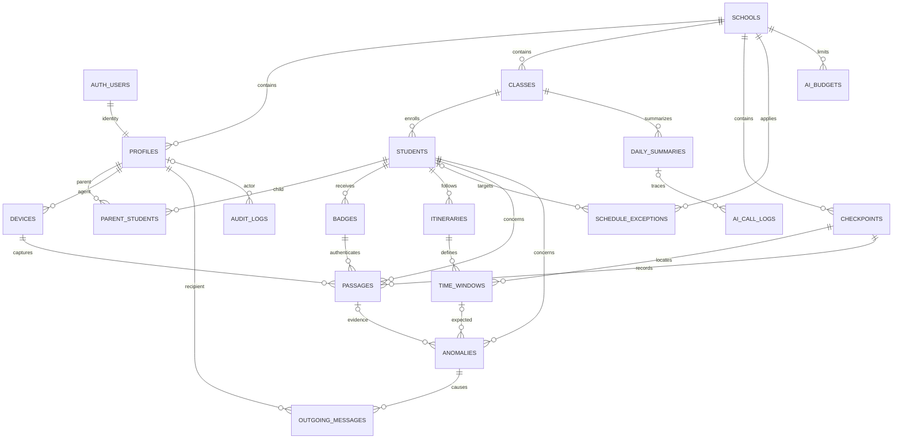

# Passage — Conception de la base de données

Statut : conception initiale J2, à implémenter et tester. Source : Test technique Afric’Éduc, sujet B, sections 2.2, 2.4, 3.2 à 3.6.

## 1. Choix de conception

PostgreSQL local via Supabase CLI. Supabase Auth gère les identités et les mots de passe ; `public.profiles` complète `auth.users`. Les migrations SQL, politiques RLS et données de démonstration sont versionnées. Les tables utilisent des UUID, des clés étrangères et des contraintes d’intégrité. Les horodatages sont en `timestamptz`, les journées métier en `date`, les fenêtres en heure locale de l’établissement (`Africa/Douala` par défaut). Le MVP retient un rôle et un établissement par compte ; l’association parent-enfant reste plusieurs-à-plusieurs.

## 2. MCD — relations principales



## 3. MLD et dictionnaire de données

Notation : PK = clé primaire ; FK = clé étrangère ; UQ = contrainte d’unicité. Sauf mention contraire, `id` est un UUID. Les FK obligatoires sont NOT NULL. Les colonnes `school_id` sont conservées sur les tables de données sensibles pour faciliter RLS et contrôlées par FK composites afin d’interdire les associations inter-établissements. Les champs techniques ne sont pas tous exposés par l’API.

| Table | Attributs principaux et contraintes |
|---|---|
| `auth.users` | Identité et authentification gérées par Supabase, non exposées au client par l’API de données. |
| `schools` | `id` PK, `name`, `timezone` (IANA), `daily_message_limit` (>= 0). |
| `profiles` | `id` PK/FK auth.users, `school_id` FK, `full_name`, `role` (MANAGER/AGENT/PARENT), `active`, `created_at`. UQ `(school_id,id)`. |
| `classes` | `id` PK, `school_id` FK, `name`, UQ `(school_id,name)`. |
| `students` | `id` PK, `school_id` FK, `class_id` FK, `full_name`, `active`, `created_at`. |
| `parent_students` | `school_id` FK, `parent_id` FK profiles, `student_id` FK students, PK `(parent_id,student_id)`. Parent doit avoir le rôle PARENT. |
| `badges` | `id` PK opaque, `school_id` FK, `student_id` FK, `public_key` JSONB (JWK public), `status` (ACTIVE/SUSPENDED/LOST/REVOKED), `issued_at`, `revoked_at` nullable, `replaces_badge_id` FK badges nullable. Aucun nom ni clé privée sur le support transmis. |
| `devices` | `id` PK, `school_id` FK, `agent_id` FK profiles, `label`, `active`, `registered_at`. Agent doit avoir le rôle AGENT. |
| `checkpoints` | `id` PK, `school_id` FK, `label`, `type` (ENTRY/EXIT/BUS), `active`. |
| `itineraries` | `id` PK, `school_id` FK, `student_id` FK, `valid_from` date, `valid_until` date nullable, `active`. |
| `time_windows` | `id` PK, `school_id` FK, `itinerary_id` FK, `checkpoint_id` FK, `position` entier positif, `starts_at` time, `ends_at` time, `weekdays` smallint[] (ISO 1–7), UQ `(itinerary_id,position)`. |
| `schedule_exceptions` | `id` PK, `school_id` FK, `student_id` FK nullable (NULL = tout l’établissement), `day` date, `type` (HOLIDAY/EXCUSED_ABSENCE/EARLY_EXIT), `reason` nullable et non exposée inutilement. |
| `passages` | `id` PK, `school_id` FK, `student_id` FK, `badge_id` FK, `checkpoint_id` FK, `device_id` FK, `local_event_id` UUID, `challenge_id` UUID, `local_time` timestamptz, `server_received_at` timestamptz généré serveur, `effective_time` timestamptz nullable, `clock_status` (TRUSTED/CORRECTED/UNRELIABLE), `validation_status` (ACCEPTED/REJECTED/REVIEW), `sync_status` (RECEIVED/PROCESSED), `payload_hash`, `proof` JSONB (non exposé aux parents), UQ `(device_id,local_event_id)`, UQ `(device_id,challenge_id)`. |
| `anomalies` | `id` PK, `school_id` FK, `student_id` FK, `passage_id` FK nullable, `time_window_id` FK nullable, `day` date, `type` (MISSING/OUTSIDE_WINDOW/UNEXPECTED_CHECKPOINT/DUPLICATE_SCAN/UNRELIABLE_CLOCK), `status` (OPEN/RESOLVED), `dedup_key`, `detected_at`, `resolved_at` nullable. UQ `(school_id,dedup_key)`. |
| `outgoing_messages` | `id` PK, `school_id` FK, `student_id` FK, `parent_id` FK, `anomaly_id` FK, `day` date, `text`, `status` (PENDING/SIMULATED/SUPPRESSED/FAILED), `suppression_reason` nullable, `created_at`. UQ `(anomaly_id,parent_id)`. |
| `daily_summaries` | `id` PK, `school_id` FK, `class_id` FK, `day` date, `facts` JSONB, `text`, `source` (MODEL/TEMPLATE), `fallback_reason` nullable, `request_hash`, `created_at`. UQ `(school_id,request_hash)`. |
| `ai_call_logs` | `id` PK, `school_id` FK, `summary_id` FK nullable, `request_hash`, `attempt`, `model`, `input_tokens`, `output_tokens`, `estimated_cost` numeric, `status`, `created_at`. |
| `ai_budgets` | `id` PK, `school_id` FK, `period_start` date, `limit_amount` numeric, `reserved_amount` numeric, `spent_amount` numeric, `currency`, UQ `(school_id,period_start)`. |
| `audit_logs` | `id` PK, `school_id` FK, `actor_id` FK nullable (système), `action`, `resource_type`, `resource_id` nullable, `created_at`, `metadata` JSONB minimal. Append-only pour les utilisateurs. |

La preuve cryptographique, le statut de validation et l’horodatage de réception sont gérés par le serveur. La file de scans à synchroniser réside dans IndexedDB, pas dans PostgreSQL. Un scan rejeté ne compte jamais comme présence. L’audit peut enregistrer les refus de rejeu sans créer un nouveau passage accepté.

## 4. Contraintes et invariants

- Un seul badge ACTIVE par élève : index unique partiel. Réémission : révocation de l’ancien badge et émission du nouveau dans une même transaction. Revalider le statut à la synchronisation ; l’agent hors ligne ne peut pas connaître une révocation instantanément.
- Tous les rattachements école/élève/badge/point/appareil doivent être cohérents. Ajouter `UNIQUE (school_id,id)` sur les tables référencées et des FK composites sur les relations concernées. Assurer également la cohérence entre l’élève du badge et l’élève du passage.
- Synchronisation idempotente : unicité de `(device_id,local_event_id)` ; une retransmission identique renvoie le résultat déjà validé. Si le contenu diffère sous la même clé, refuser le conflit. Unicité de `(device_id,challenge_id)` pour refuser une autre tentative de consommation du même challenge. Les deux règles sont distinctes de l’anomalie métier DOUBLE SCAN (deux véritables scans à moins de 60 secondes).
- Le challenge est aléatoire, lié à l’appareil et au point de contrôle et signé avec l’identifiant du badge. Vérification locale, consommation atomique locale et vérification serveur. La clé privée reste sur le support de badge. Le MVP suppose un badge numérique interactif ; les relais en temps réel et la compromission d’un appareil sortent de la garantie du prototype.
- Horloge : conserver l’heure brute et l’heure de réception ; déterminer une heure effective seulement lorsque la référence temporelle est suffisamment fiable. Sinon REVIEW et anomalie UNRELIABLE_CLOCK, sans inférer un retard.
- Fenêtres : `starts_at < ends_at`, jours valides et non vides ; MVP sans fenêtre traversant minuit. Les dates de fin d’itinéraire ne précèdent pas les dates de début. Éviter les itinéraires actifs simultanés pour un élève sur la même période.
- Détection MISSING : worker planifié indépendant de l’interface, création idempotente par élève/fenêtre/journée. Réévaluer à l’arrivée des passages hors ligne ; résolution si une preuve fiable montre que le passage a eu lieu dans la fenêtre. Une exception applicable supprime ou résout les anomalies de la journée selon la règle du sujet.
- Notifications : insertion atomique de l’anomalie et des messages ; plafond par élève/jour, y compris en concurrence, avec verrou ou compteur transactionnel. Au-delà, enregistrer SUPPRESSED et le motif. Le choix MVP compte chaque message destiné à un parent dans le plafond.
- Synthèse IA : calculer les faits côté serveur ; cache par empreinte canonique des faits, école, classe, jour, version de prompt, modèle et schéma. Réserver le coût maximal avant chaque appel (y compris l’unique retry autorisé en cas de sortie non conforme) ; réconcilier le coût estimé après réponse et éviter les appels concurrents identiques par verrou/état de traitement. Le gabarit local ne consomme pas de budget.

Exemples d’index (à intégrer aux migrations, non exécutés) :

```sql
CREATE UNIQUE INDEX badges_one_active_per_student
  ON public.badges (student_id) WHERE status = 'ACTIVE';

CREATE UNIQUE INDEX passages_event_unique
  ON public.passages (device_id, local_event_id);

CREATE UNIQUE INDEX passages_challenge_unique
  ON public.passages (device_id, challenge_id);

CREATE INDEX passages_student_time
  ON public.passages (school_id, student_id, effective_time);
```

## 5. Politiques RLS et autorisations

Tout accès est refusé par défaut. Activer RLS pour toutes les tables exposées et restreindre les GRANT. Les identités et rôles viennent de `auth.uid()` et de profils non modifiables par les utilisateurs ; aucune autorisation ne repose sur un rôle envoyé par le client. Les accès du responsable sont bornés à son établissement. Le rôle agent est limité à ses appareils et au scan ; il ne reçoit ni statistiques, ni anomalies, ni données des parents. Le parent peut consulter uniquement les élèves reliés à son compte et les passages/anomalies de ces élèves.

| Ressource | Responsable | Agent | Parent |
|---|---|---|---|
| Profil | Son profil ; gestion des rôles hors périmètre courant | Son profil | Son profil |
| Écoles, classes, élèves, itinéraires, exceptions, badges | Lecture et gestion autorisée de son école | Pas d’accès aux données nominatives ; métadonnées minimales du scan via API dédiée | Lecture minimale de ses enfants, pas de clés de badge |
| Points de contrôle et appareils | Gestion de son école | Points autorisés et ses appareils | Aucun |
| Passages | Lecture de son école | Synchronisation via API dédiée ; pas de lecture générale | Lecture des passages de ses enfants, champs non sensibles uniquement |
| Anomalies | Lecture de son école | Aucun | Lecture des anomalies de ses enfants |
| Messages | Lecture de son école si nécessaire | Aucun | Pas d’accès direct requis |
| Synthèses | Lecture/génération de son école | Aucun | Aucun |
| Coûts IA et audit | Accès restreint selon besoin ; écriture système | Aucun | Aucun |

Les écritures métier sensibles (émission, révocation, synchronisation, anomalies, notifications, synthèses) passent par les Edge Functions et des RPC transactionnelles. Les opérations privilégiées ne sont pas appelables directement par les utilisateurs ordinaires. Vérifier le JWT, le rôle, l’établissement, l’appareil et l’autorisation de l’objet à chaque requête ; utiliser de préférence un client Supabase au contexte de l’utilisateur. Si un client privilégié est nécessaire, effectuer ces contrôles explicitement avant utilisation. Une clé secrète ou service_role ne doit jamais figurer dans le frontend ou le dépôt.

Les politiques RLS contrôlent les lignes, pas la visibilité des colonnes : exposer des vues/projections sûres ou des endpoints dédiés pour masquer les preuves cryptographiques et les données techniques. Les helpers SQL éventuellement SECURITY DEFINER auront des privilèges minimaux, un search_path fixé, des noms qualifiés et des droits d’exécution explicitement restreints.

## 6. Données initiales et validation

Seed reproductible, exclusivement fictif : 1 établissement, 1 classe, 1 responsable, 1 agent, 2 parents, 5 élèves dont au moins 2 reliés au même parent, 2 points de contrôle, des itinéraires et des passages produisant au moins trois types d’anomalies. Créer les comptes par un script local d’administration Supabase Auth et utiliser des valeurs de démonstration configurables, jamais de secrets réels dans Git.

Tests prioritaires :

1. Deux parents ne peuvent lire les élèves l’un de l’autre, même via une requête directe ; l’agent ne peut lire ni les anomalies ni les statistiques ; test inter-école.
2. Vingt scans valides hors ligne, synchronisation interrompue puis reprise : exactement vingt passages acceptés ; un UUID rejoué avec un contenu différent est refusé.
3. Réutilisation d’un challenge sur le même appareil ou sur un autre appareil : refus ; réémission et badge révoqué : refus serveur.
4. Fenêtre clôturée sans passage : anomalie automatique unique, puis réconciliation si un passage fiable arrive tardivement ; exception applicable respectée.
5. Horloge décalée de deux heures : correction justifiée ou statut REVIEW, sans fausse présence ni faux retard.
6. Plafond de notifications respecté même en concurrence ; anomalies conservées.
7. Sans clé IA, gabarit exact ; réponse invalide, retry puis repli ; chiffres identiques aux faits calculés ; cache et plafond de coûts respectés.

## 7. Points à valider après J2

Ce document est un modèle initial, pas une migration exécutable. Les types SQL précis, les triggers, les fonctions RPC, les politiques RLS, les tests et les scripts de peuplement restent à implémenter. La faisabilité du badge numérique, de Supabase local hors Internet et du déclenchement automatique sera vérifiée sur la machine de démonstration. Les compromis (compte mono-établissement, badge interactif, fenêtres sans passage à minuit) doivent figurer dans DECISIONS.md.
