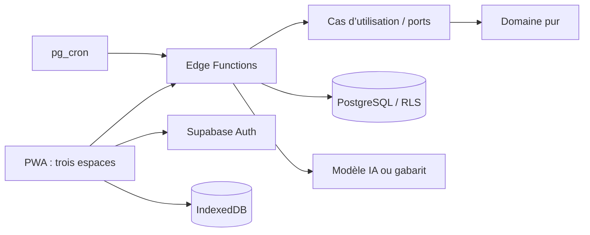
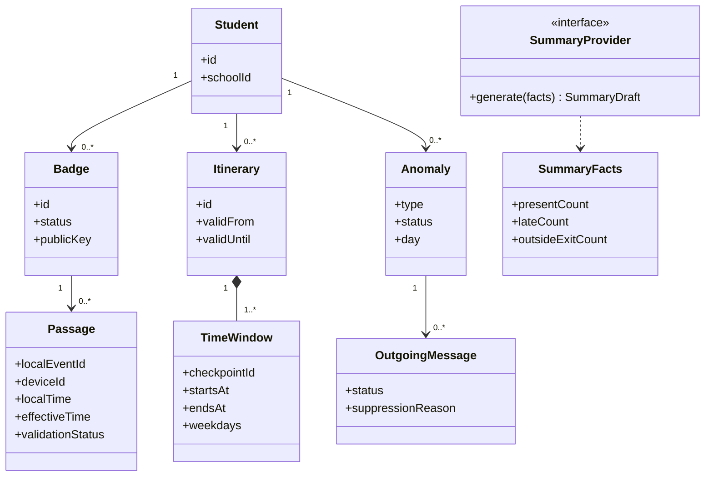
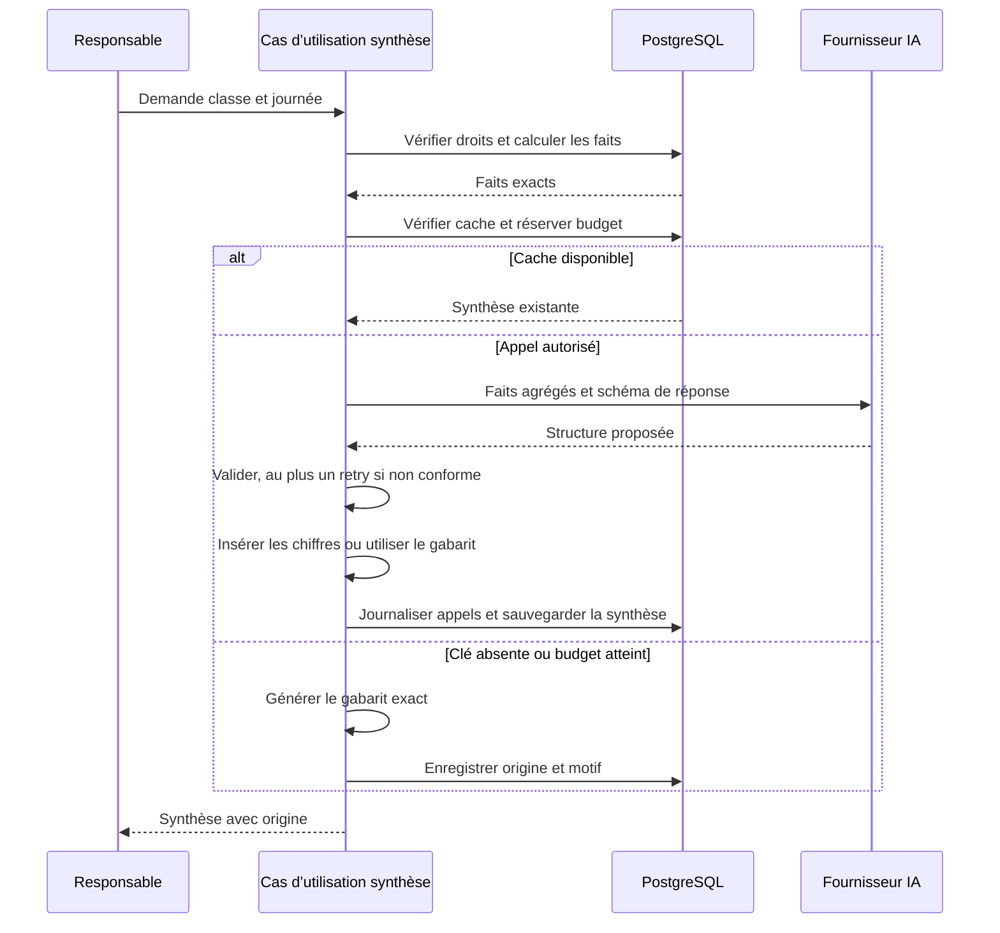

# Document de conception — Passage

| Information | Valeur |
|---|---|
| Projet | Passage — suivi des passages d’élèves |
| Cadre | Test technique Afric’Éduc, sujet B |
| Version | Conception initiale J2 — 25 novembre 2026 |
| Statut | Choix architecturaux validés ; modèle de données et protocoles à éprouver |

## 1. Objet du document

Ce document central présente la conception du projet et renvoie aux documents spécialisés. Il distingue les exigences du sujet des hypothèses retenues et ne constitue pas une preuve d’implémentation. La conception vise un prototype sécurisé, modulaire, testable et utilisable localement dans le délai du test.

## 2. Périmètre et acteurs

Le responsable gère les référentiels et consulte les événements ; l’agent scanne hors réseau et synchronise ; le parent ne consulte que les données de ses enfants. Le planificateur détecte les passages manquants, indépendamment de l’interface. Les notifications sont simulées et les synthèses utilisent une IA facultative à l’exécution.

Les cas d’utilisation et les règles métier sont décrits dans [FUNCTIONAL-ANALYSIS.md](FUNCTIONAL-ANALYSIS.md) ; la priorisation et les critères d’acceptation dans [MVP.md](MVP.md).

## 3. Architecture de solution

Une PWA React/TypeScript, une infrastructure locale Supabase/PostgreSQL et des modules métier TypeScript/Deno. La présentation, les cas d’utilisation, le domaine et les adaptateurs sont séparés selon la Clean Architecture. Les données persistantes et les transactions sont protégées par des contraintes et des autorisations. Les cas d’utilisation ne dépendent pas des SDK externes.

Voir [ARCHITECTURE.md](ARCHITECTURE.md) pour les dépendances, les modules et SOLID ; [DECISIONS.md](../DECISIONS.md) pour les options écartées.

## 4. Modèle de domaine illustratif

Le diagramme suivant représente les concepts à concevoir, pas des classes TypeScript déjà implémentées. Il ne prescrit pas une classe pour chaque table SQL.

Le MCD, le MLD, les contraintes, les propositions d’index et la stratégie RLS sont détaillés dans [DATABASE.md](DATABASE.md). Le MPD exécutable sera matérialisé par les migrations SQL, non encore validées.

## 5. Principaux scénarios de conception

- **Badge et scan :** challenge unique créé par l’agent, réponse signée par un support numérique, vérification locale, puis preuve réexaminée par le serveur. Le support interactif reste une hypothèse à valider.
- **Synchronisation :** stockage persistant, UUID immuables, acquittement individuel et reprise ; l’idempotence est garantie à la frontière transactionnelle.
- **Fenêtre clôturée :** détection automatique d’un événement absent, anomalie dédupliquée, message enregistré ou suppression motivée, réconciliation en cas de réception tardive.
- **Parent :** session valide, contrôle de rôle et de rattachement, consultation limitée aux enfants autorisés.

Les diagrammes de séquence et la politique d’horodatage sont disponibles dans [OFFLINE-STRATEGY.md](OFFLINE-STRATEGY.md). Les routes HTTP et contrats DTO seront finalisés lors de la conception de l’API ; ils ne sont pas annoncés comme existants.

## 6. Synthèse IA : conception du flux

Les faits sont calculés à partir des passages acceptés et des anomalies pertinentes ; les passages en revue et les exceptions doivent être traités explicitement. Le modèle choisit une formulation autorisée, sans produire librement les chiffres. Exemple de sortie contrainte proposée : un objet avec `introStyle`, `delayStyle` et `exitStyle`, chacun appartenant à un ensemble fermé de valeurs. Le renderer déterministe insère les nombres calculés. Un test compare tous les chiffres du texte aux faits attendus.

Le cache identifie les faits et paramètres de génération ; un verrou évite deux appels concurrents pour une demande identique. Un coût maximal est réservé avant chaque tentative et le coût estimé est enregistré avec modèle, horodatage et volume. Sans clé, sur indisponibilité, après une sortie non conforme répétée ou si le plafond est atteint, un gabarit local prend le relais. Aucun nom d’élève ou de parent n’est transmis au fournisseur.

## 7. Sécurité et validation

Le contrôle des rôles relève du serveur, l’isolation parent-enfant est garantie au niveau des accès aux données, les transactions empêchent les doublons, les sessions sont limitées et les secrets restent hors Git. La stratégie de sécurité figure dans [SECURITY.md](SECURITY.md) et les preuves de validation attendues dans [TESTING.md](TESTING.md).

## 8. Traçabilité et limites

| Exigence du sujet | Documents de conception | Preuve attendue |
|---|---|---|
| Sécurité (2.2, 3.2) | SECURITY, DATABASE | Tests négatifs et RLS |
| Badge et hors ligne (3.3, 3.4) | OFFLINE-STRATEGY, DECISIONS | Rejeu refusé, vingt scans et reprise |
| Anomalies et notifications (3.3) | FUNCTIONAL-ANALYSIS, DATABASE | Déclenchement sans client et plafond |
| IA (2.4, 3.3) | DESIGN, DECISIONS | Sortie contrainte, exactitude, coût et repli |
| Reproductibilité et tests (2.1, 2.6) | README, TESTING | Clone vierge, seed et CI |
| Restitution et vidéos (2.5, 4) | ROADMAP | Deux vidéos, démonstration et modification en direct |

La conception est amendable. Les points prioritaires à vérifier sont le support du badge, la compatibilité du protocole hors ligne, les sessions et RLS, le démarrage local de Supabase, la planification automatique et l’exécution CI. Le planning est disponible dans [ROADMAP.md](ROADMAP.md).
