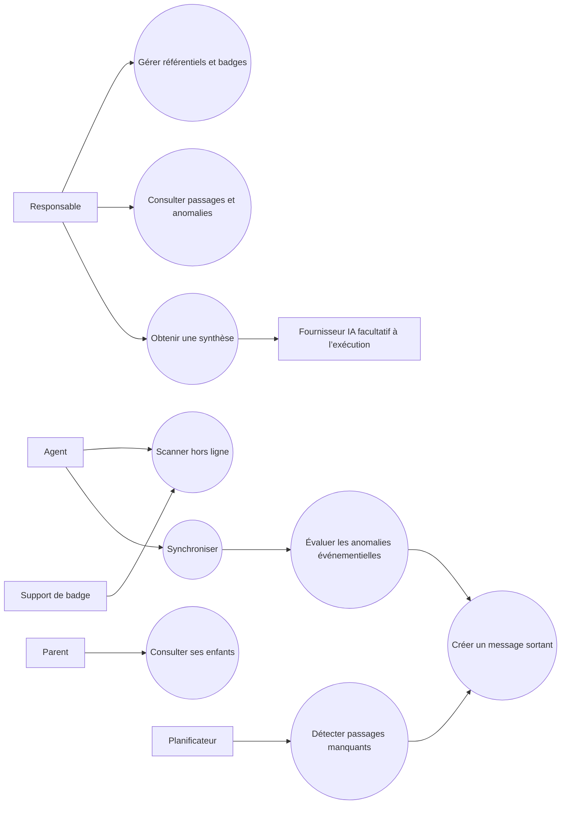

# Analyse fonctionnelle — Passage

Statut : conception initiale J2. Source : sujet B, sections 3.1 à 3.4.

## Contexte et objectifs

SchoolLogs doit suivre les passages d’élèves aux points de contrôle d’un établissement (entrée, sortie, autobus). Un passage attendu manquant ou un passage inattendu doit produire une information destinée au parent. Le réseau du portail peut être indisponible et l’horloge de l’agent incorrecte. Une photographie du badge ne doit pas suffire à usurper son titulaire.

## Acteurs et cas d’utilisation

| Acteur | Cas d’utilisation |
|---|---|
| Responsable | Gérer les élèves, leurs rattachements, badges, points de contrôle, itinéraires et exceptions ; consulter passages et anomalies ; demander une synthèse par classe et jour. |
| Agent | S’authentifier, préparer son appareil, scanner au point autorisé, consulter l’état de sa file et synchroniser ses scans. |
| Parent | S’authentifier, sélectionner un enfant rattaché, consulter ses passages et anomalies. |
| Planificateur | Détecter les fenêtres clôturées sans passage et déclencher le traitement associé sans intervention humaine. |
| Fournisseur IA | Proposer une formulation contrainte des faits agrégés ; ne prend aucune décision de présence. |
| Support de badge | Répondre à un challenge cryptographique ; composant technique proposé, non quatrième rôle métier. |

## Parcours principaux

| Parcours | Préconditions | Résultat attendu | Cas d’erreur |
|---|---|---|---|
| Émettre un badge | Responsable autorisé, élève actif | Badge actif et identifiant opaque ; ancienne émission révoquée si remplacement | Élève inconnu, rôle non autorisé, preuve de provisioning invalide |
| Scanner | Agent préalablement authentifié, appareil et point autorisés, support de badge disponible | Événement identifié, preuve cryptographique et heure locale conservées | Signature invalide, challenge consommé, stockage indisponible |
| Synchroniser | Connexion rétablie, session valide | Enregistrement durable une seule fois ; acquittement par événement | Coupure : conserver les non-acquittés ; conflit d’identifiant : signaler |
| Détecter un passage manquant | Fenêtre close, aucune exception applicable | Anomalie unique et message sortant ou motif de suppression | Passage tardivement synchronisé : réévaluer |
| Consulter un enfant | Parent authentifié et lien parent-enfant valide | Passages et anomalies de cet enfant seulement | Identifiant d’un autre enfant : refus serveur |
| Générer la synthèse | Responsable autorisé sur la classe et la journée | Faits exacts, texte et origine modèle/gabarit | Clé absente, budget dépassé, service indisponible, sortie invalide : repli |

## Règles métier

| ID | Règle |
|---|---|
| RG01 | Un seul badge actif par élève ; une réémission invalide l’ancien badge. |
| RG02 | États de badge : actif, suspendu, perdu, révoqué ; aucune donnée nominative sur le support. |
| RG03 | Une photographie du badge ne suffit pas à authentifier un nouveau passage. |
| RG04 | Un agent doit pouvoir enregistrer ses scans sans réseau après préparation de son appareil. |
| RG05 | Chaque événement logique doit être enregistré au plus une fois ; les vingt scans valides de vérification doivent être conservés. |
| RG06 | Chaque passage conserve l’heure locale, l’heure serveur et l’identifiant de l’appareil ; l’heure non fiable ne détermine pas seule une présence ou un retard. |
| RG07 | Un itinéraire contient des points ordonnés avec fenêtres horaires et jours d’application. |
| RG08 | Jours fériés, absences justifiées et sorties anticipées autorisées suspendent la détection d’anomalies pour la journée concernée. |
| RG09 | Une fenêtre close sans passage valide déclenche une anomalie automatiquement. |
| RG10 | Une validation hors fenêtre ou à un point non prévu génère une anomalie. |
| RG11 | Deux scans distincts du même badge à moins de 60 secondes génèrent une anomalie ; une retransmission technique n’est pas un second scan. |
| RG12 | Cinquième anomalie proposée : heure de passage non fiable. |
| RG13 | Chaque anomalie génère un message neutre destiné au parent, sauf plafond atteint ; la suppression est tracée. Aucun SMS réel exigé. |
| RG14 | Un parent ne peut consulter que les données de ses enfants ; l’agent ne consulte ni parents, ni anomalies, ni statistiques. |
| RG15 | Les chiffres d’une synthèse sont calculés par le code et vérifiés par test, jamais inventés par le modèle. |
| RG16 | Sortie IA strictement contrôlée, une seule nouvelle tentative si non conforme, coût journalisé et plafonné, cache et gabarit de secours. |

## Exigences non fonctionnelles

Sécurité côté serveur, données de mineurs minimisées, disponibilité du scan hors réseau, intégrité transactionnelle, interface sobre adaptée au téléphone, environnement local reproductible, tests automatisés, traçabilité des décisions et de l’usage IA. Le document ne demande ni hébergement en production ni interface graphique élaborée.

## Hypothèses à confirmer ou éprouver

Le badge interactif suppose un support capable de signer ; un badge imprimé passif ne satisfait pas ce protocole. Le MVP suppose un rôle et un établissement par compte, des fenêtres ne traversant pas minuit et un fuseau par établissement. La gestion des messages lors d’une synchronisation tardive et le plafonnement lorsqu’il existe plusieurs parents doivent être validés ou assumés dans DECISIONS.md.
