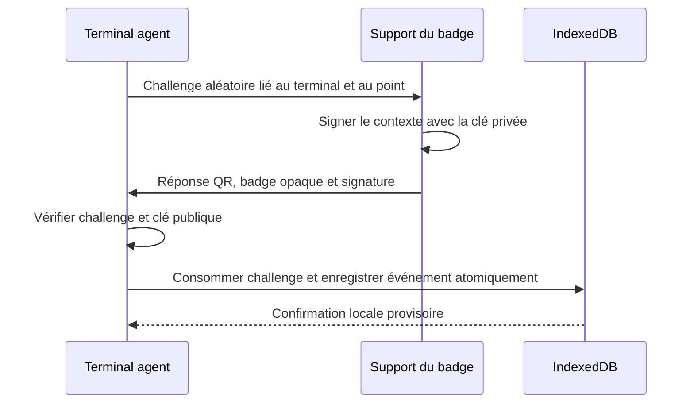
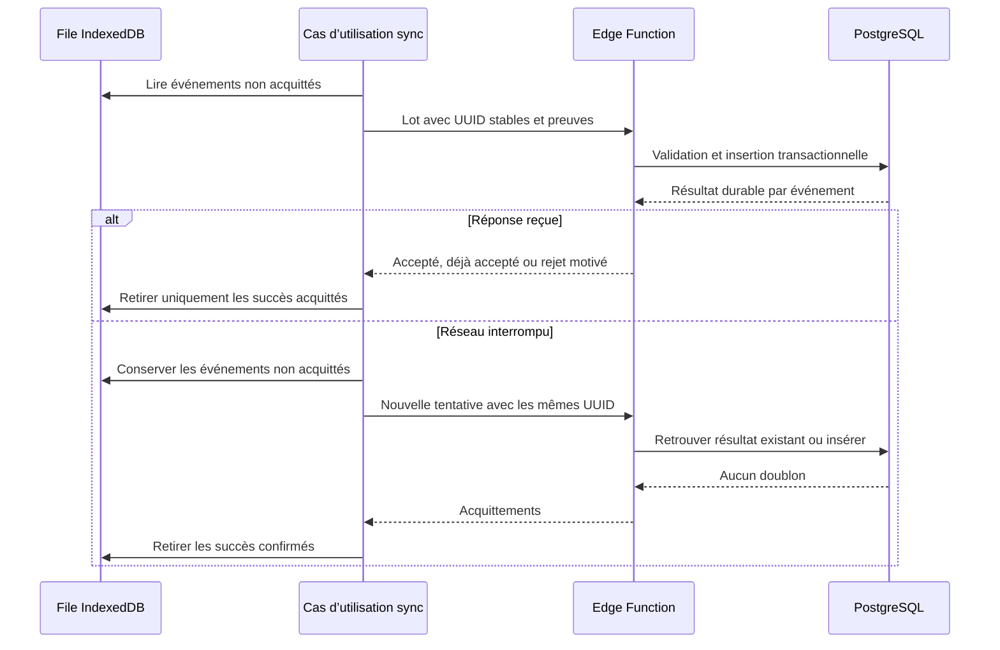

# Stratégie hors ligne et synchronisation

Statut : validation locale des QR signés, persistance IndexedDB et synchronisation serveur idempotente implémentées ; l’écran Agent reste à implémenter et le parcours complet à éprouver. Source : sujet B, sections 3.3, 3.4 et 3.6.

## État implémenté

Le cas d’utilisation Agent vérifie hors ligne la signature ECDSA, l’établissement, la période de validité et les révocations connues. `BaseLocaleAgent`, fondée sur IndexedDB via Dexie, conserve les clés publiques, les révocations, les QR consommés, les passages en attente, les tentatives et les anomalies locales.

La consommation réussie est atomique : le QR consommé, le passage en attente et la tentative sont écrits dans une seule transaction Dexie. Une réutilisation est refusée et crée une tentative ainsi qu’une anomalie locale ; aucun événement en attente n’est supprimé.

## 1. Périmètre

L’espace Agent doit fonctionner sans connexion après une préparation en ligne : authentification, autorisation de l’appareil et du point, cache de l’écran de scan et des ressources cryptographiques nécessaires. Les espaces Responsable et Parent ne requièrent pas un mode hors ligne complet. Le mode hors Internet de la restitution (serveur local accessible) est distinct du mode sans accès au serveur du portail.

## 2. Stockage et cycle de vie

Service Worker pour les ressources statiques de la PWA ; IndexedDB via Dexie pour la file persistante. Aucune réponse privée générique n’est mise en cache. Une file est partitionnée par appareil et identité autorisée ; elle n’est pas accessible dans l’espace d’un autre utilisateur.

| Champ local proposé | Rôle |
|---|---|
| `localEventId` | UUID généré une seule fois au moment du scan |
| `deviceId`, `checkpointId` | Contexte du terminal et du point |
| `badgeId`, `challengeId`, `proof` | Identifiants opaques et preuve signée |
| `localTime` | Heure brute de l’appareil |
| `clockReference`, `elapsedMs` | Référence temporelle et durée monotone si valides |
| `state`, `attemptCount`, `lastError` | État local et diagnostic minimal |

États envisagés : `PENDING`, `SENDING`, `REVIEW` ou `REJECTED` ; un événement acquitté positivement est retiré de la file active. Un rejet définitif doit rester visible, sans être compté comme passage validé. Au redémarrage, un état `SENDING` interrompu redevient éligible à une tentative. Les écritures dans IndexedDB et la consommation du challenge local doivent être atomiques. Si le stockage échoue, l’agent ne doit pas voir un succès trompeur.

## 3. Protocole du badge proposé

Le challenge et la réponse utilisent un format canonique et versionné pour éviter les ambiguïtés de signature. Le challenge est généré par l’agent, non par le badge photographiable. Le terminal vérifie qu’il correspond à un challenge encore actif qu’il a réellement créé ; une réponse destinée à un autre appareil ou un challenge consommé est refusé. Le serveur doit vérifier à son tour la signature, l’appareil autorisé, le contexte et le statut du badge. L’événement est provisoire tant qu’il n’a pas été accepté côté serveur.

Une session de scan hors ligne doit avoir une durée d’autorisation bornée, indépendante de l’accès aux autres espaces. Après expiration, suspendre les nouveaux scans et conserver la file jusqu’à réauthentification autorisée. Les détails de provisioning et de durée de validité seront arrêtés après le prototype.

## 4. Synchronisation idempotente

Déclenchement au retour de connexion, à la réouverture de l’écran ou sur action manuelle ; `navigator.onLine` est seulement un indice. Le navigateur n’est pas supposé garantir la synchronisation lorsque l’application est fermée. Un verrou local empêche plusieurs processus de vider simultanément la même file.

Le serveur vérifie d’abord identité et autorisation d’appareil. Pour un événement déjà traité de façon identique, il renvoie son résultat durable sans créer une nouvelle anomalie ou réévaluer la preuve comme un nouveau scan. Même clé et contenu différent : conflit explicite. Nouveau scan : vérification cryptographique et métier, puis transaction avec contrainte unique `(device_id, local_event_id)` et contrainte de consommation du challenge. La comparaison d’empreinte utilise une représentation canonique des données immuables.

Les acquittements concernent chaque événement, pas seulement le lot. Les erreurs transitoires entraînent une nouvelle tentative bornée avec temporisation croissante ; les rejets permanents sont signalés séparément. Les écritures concurrentes doivent être testées, pas seulement simulées côté client.

## 5. Horloge de l’appareil

Lors d’un échange en ligne, conserver une référence temporelle serveur et la lecture du compteur monotone du navigateur ; estimer ensuite l’heure effective par l’écart monotone tant que la référence reste fiable. Conserver dans tous les cas l’heure locale brute et la réception serveur. Détecter les écarts manifestes, notamment deux heures, et ne pas utiliser la réception comme heure réelle pour les scans retardés.

Après redémarrage, suspension prolongée ou référence trop ancienne, ne pas reconstruire artificiellement une heure. Marquer le passage pour revue et créer l’anomalie `UNRELIABLE_CLOCK` si aucune exception ne suspend la détection. La durée de validité et les tolérances sont à définir et tester. Un terminal compromis peut falsifier son contexte : le modèle de menace n’offre pas une preuve absolue du temps hors réseau.

## 6. Anomalies et synchronisation tardive

Le planificateur détecte une absence de passage à la clôture même si aucun client n’est connecté. Comme la coupure peut masquer un scan effectué à l’heure, l’anomalie est réévaluable : un passage fiable reçu ultérieurement dans sa fenêtre doit résoudre le passage manquant. Conserver la trace et l’état du message déjà simulé ; la politique de message rectificatif reste à préciser, sans envoi réel. Les exceptions suspendent la détection du jour concerné.

## 7. Critères de validation

Vingt scans hors ligne doivent survivre à une interruption et produire vingt passages, pas dix-neuf ni vingt et un. Tester une coupure après insertion serveur, le rechargement de l’écran, les réponses partielles, le rejeu d’une photographie sur un autre appareil, le décalage d’horloge et le changement d’utilisateur. Tester la PWA construite dans un contexte HTTPS ou localhost ; un téléphone connecté à une adresse IP locale non sécurisée peut ne pas disposer de la caméra ou du Service Worker.
